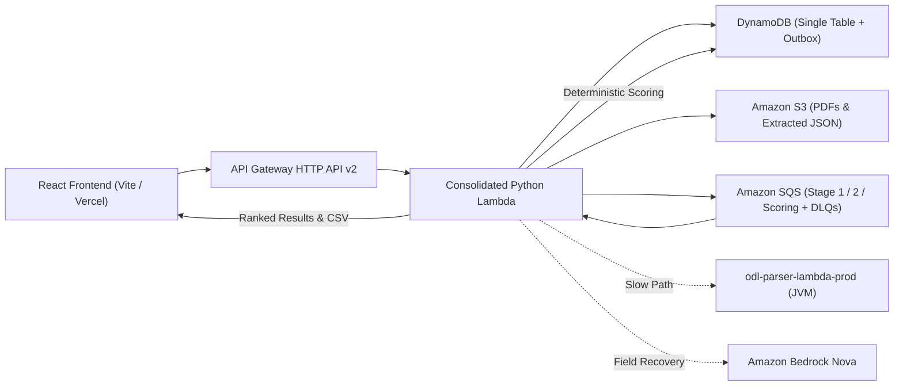
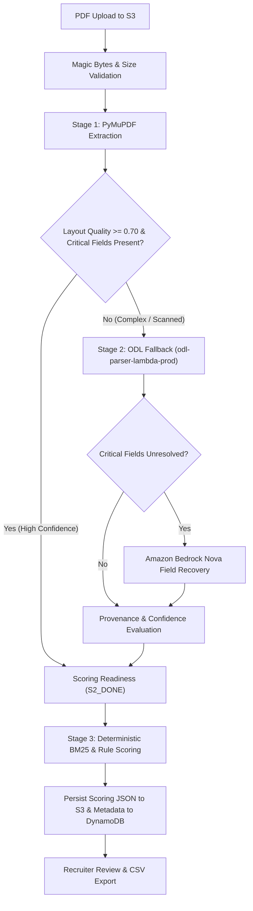
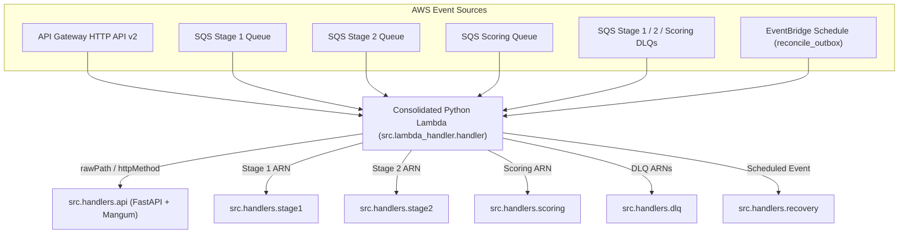
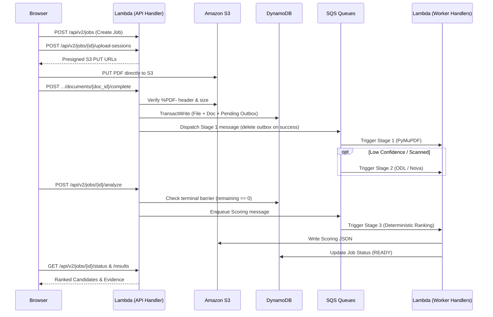
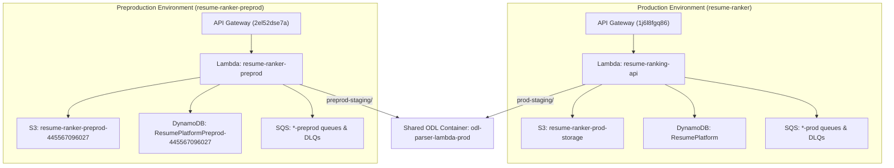
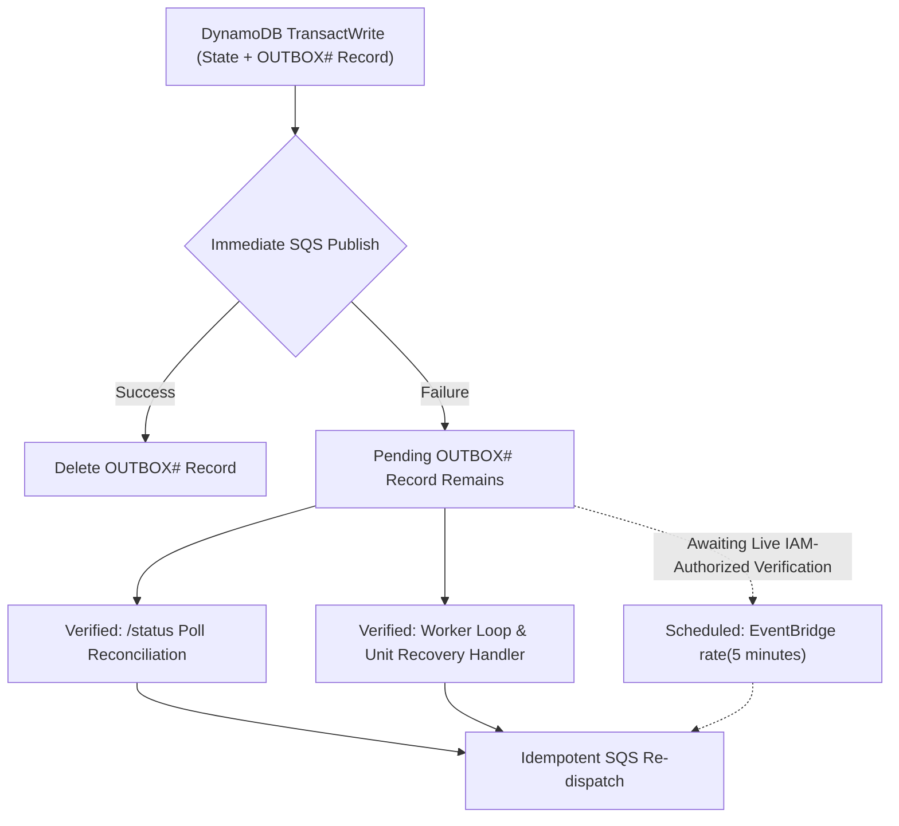

# SWYRA Sortlist (Resume Ranker v2.1)

**GitHub About:** *Standalone, evidence-based resume ranking and ATS analysis engine powered by PyMuPDF, OpenDataLoader PDF, Amazon Bedrock Nova, and deterministic scoring on AWS Lambda.*

SWYRA Sortlist is a standalone, evidence-based resume ranking and ATS analysis engine. It processes bulk PDF resumes through a multi-stage serverless pipeline, using AI selectively for low-confidence field recovery rather than as the final ranking decision-maker.

## Core Capabilities

- **High-Throughput PDF Processing**: Native PyMuPDF (`fitz`) extraction for clean, single-column PDFs.
- **Confidence-Based Fallback**: Automatic routing to shared OpenDataLoader PDF (`odl-parser-lambda-prod`) for complex/multi-column layouts and Amazon Bedrock Nova for unresolved critical fields.
- **Deterministic Candidate Ranking**: Explainable, reproducible scoring using BM25 keyword matching, skills matching, experience/education evaluation, and configurable score weights.
- **Standalone ATS Analysis**: Dedicated `/api/v2/ats-check` endpoint evaluating section detection, formatting, layout quality, extraction warnings, and contact info.
- **Independent Job Execution**: Standalone engine without in-app user accounts or authentication (`HC-01`, `ADR-07`).
- **Transactional Outbox Durability**: Atomic `transact_write_items` outbox commits in DynamoDB preventing lost SQS dispatches, paired with job-version pinning (`job_version`).
- **Recruiter Review & Export**: Shortlisting, rejection with mandatory reason, notes, and CSV export.

---

## Technology Stack

| Layer | Technologies & Verified Versions |
|---|---|
| **Frontend** | React `19.2.6`, TypeScript `~6.0.2`, Vite `8.0.12`, Tailwind CSS `4.3.1`, Zustand `5.0.14`, React Router `7.18.2`, `react-pdf` `10.4.1`, `pdfjs-dist` `6.2.108`, `shadcn` `4.11.0`, `lucide-react` `1.21.0` |
| **Backend** | Python `>=3.13`, FastAPI `>=0.115.0`, Mangum `>=0.19.0`, Pydantic Settings `>=2.14.2`, `boto3` `>=1.43.36`, Uvicorn `>=0.34.0` |
| **PDF & AI Extraction** | PyMuPDF (`pymupdf>=1.27.2.3`), OpenDataLoader PDF (external JVM Lambda `odl-parser-lambda-prod`), Amazon Bedrock Nova (`amazon.nova-*`) |
| **Ranking Algorithms** | Deterministic BM25, TF-IDF role matching, rule-based experience/education/skill evaluators, ATS geometry scoring |
| **AWS Infrastructure** | AWS Lambda (`python3.13`, 1024 MB), API Gateway HTTP API v2, Amazon S3, Amazon DynamoDB (Single-Table), Amazon SQS (3 stage queues + 3 DLQs), Amazon EventBridge |
| **Testing & CI/CD** | `pytest` `>=9.1.1`, Playwright (`@playwright/test` `1.62.1`), ESLint `10.3.0`, AWS SAM CLI, GitHub Actions (`workflow_dispatch`), Vercel |

---

## Architecture Diagrams

### Diagram A: High-Level System Architecture



### Diagram B: PDF Processing Pipeline



### Diagram C: Consolidated Lambda Event Dispatcher



### Diagram D: Upload and Analysis Sequence



### Diagram E: Production and Preproduction Isolation



### Diagram F: Transactional Outbox and Recovery



---

## 5. Benchmarks & Measured Performance

### Local Fast-Path Benchmark (47 Resumes)
Measured on local Stage 1 (PyMuPDF) + Stage 3 (Deterministic Scoring) fast-path:

| Metric | Measured Result |
|---|---:|
| Resume count | 47 |
| Stage 1 extraction | 1.18s |
| Stage 3 scoring | 0.34s |
| Combined duration | 1.52s |
| Throughput | 31.02 resumes/s |

*Note: Local fast-path benchmarks exclude network upload latency and paid external fallback execution (ODL/Nova). Default local worker concurrency is 4 (configurable up to 6 for bulk runs).*

### Live AWS Preproduction Benchmarks (`resume-ranker-preprod`)
Measured end-to-end in `ap-south-1` (`python3.13`, 1024 MB allocated, **288 MB peak observed memory**, 0 Lambda throttles):

| Resumes | Clean Path Duration | Mixed Fallback Path Duration | Clean Throughput | Mixed Throughput |
|---:|---:|---:|---:|---:|
| 1 | 2.49s | 3.13s | 0.40 res/s | 0.32 res/s |
| 5 | 3.77s | 7.04s | 1.33 res/s | 0.71 res/s |
| 47 | 24.81s | 29.11s | 1.89 res/s | 1.61 res/s |
| 100 | 52.14s | 71.13s | 1.92 res/s | 1.41 res/s |

*Methodology Note: End-to-end timings include client-to-S3 network upload latency. For the 100-resume mixed fallback workload, S3 upload accounted for 58.02s of the 71.13s total duration, making network upload the dominant bottleneck. Field coverage metrics are not represented as semantic extraction accuracy.*

---

## 6. Scoring & Engineering Policy

- **Deterministic Ranking**: Final candidate scores are computed deterministically from extracted skills, experience duration, education, BM25/keyword relevance, and ATS health signals.
- **No Prestige Bias**: Employer names and university prestige are excluded from scoring to prevent bias.
- **Identity Confidence**: Unresolved candidate identities are surfaced as `Name needs review` rather than guessing, even when partial name text is present.
- **Human-in-the-Loop**: AI (Bedrock Nova) is restricted to recovering missing fields on low-confidence PDFs; it never assigns final candidate rankings.

---

## 7. Installation & Developer Experience

### Prerequisites
- Python `>=3.13` and `uv`
- Node.js `>=24` and `npm`
- AWS CLI & AWS SAM CLI (for cloud deployments)

### Local Setup

```bash
# 1. Clone repository
git clone https://github.com/SGOD-pro/resume_ranker.git
cd resume_ranker

# 2. Backend setup
cd backend
uv sync --frozen
cd ..

# 3. Frontend setup
cd frontend
npm ci
cd ..
```

### Running Locally

```bash
# Start Backend (from backend/)
uv run uvicorn src.main:app --host 127.0.0.1 --port 8000 --reload

# Start Frontend (from frontend/)
npm run dev
```

### Connecting Local Frontend to AWS Preproduction

Set `frontend/.env`:
```env
VITE_API_BASE_URL=https://2el52dse7a.execute-api.ap-south-1.amazonaws.com
```

### Testing & Verification

```bash
# Backend unit, guardrail, and integration tests
cd backend && uv run pytest

# Frontend lint & production build
cd frontend && npm run lint && npm run build

# Playwright E2E suite
cd frontend && npx playwright test
```

### Environment Variables Reference

| Variable | Scope | Description |
|---|---|---|
| `ENVIRONMENT` | Required | `local`, `preprod`, or `prod` |
| `S3_BUCKET_NAME` | Required (AWS) | Target S3 bucket for PDFs and JSON artifacts |
| `DYNAMODB_TABLE_NAME` | Required (AWS) | Single-table DynamoDB name |
| `USE_REAL_SQS` | Optional | `"true"` in AWS, `"false"` for local in-memory queues |
| `ODL_STAGING_BUCKET` | Required (AWS) | Shared ODL staging bucket (`pdf-test-bucket-09`) |
| `ODL_STAGING_PREFIX` | Required (AWS) | `preprod-staging` or `prod-staging` |
| `FRONTEND_URL` | Required (Prod) | Comma-separated allowed CORS/CSRF origins |
| `VITE_API_BASE_URL` | Frontend | Backend API URL |

### SAM Build & Deployment

```bash
# Validate templates
sam validate -t infra/template.yaml --region ap-south-1
sam validate -t backend/deploy/template.yaml --region ap-south-1

# Build production package
sam build -t infra/template.yaml
```
