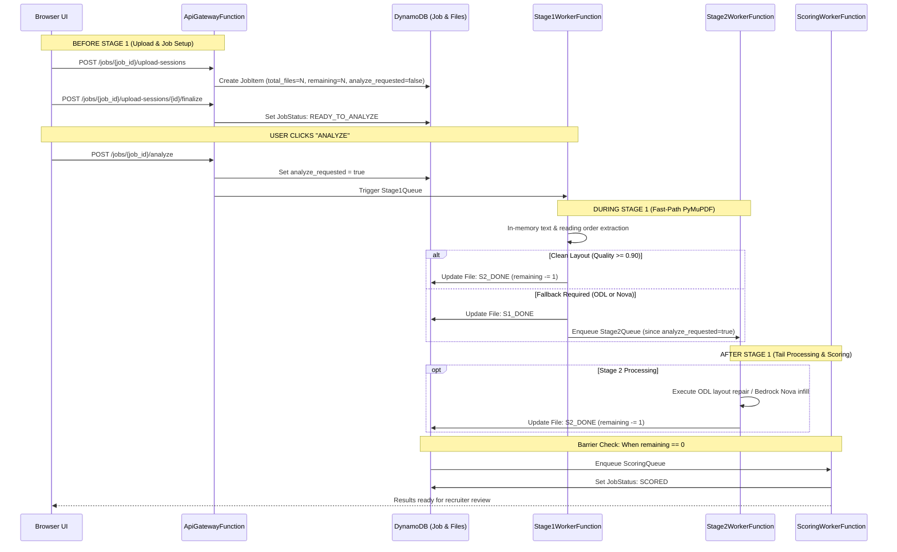
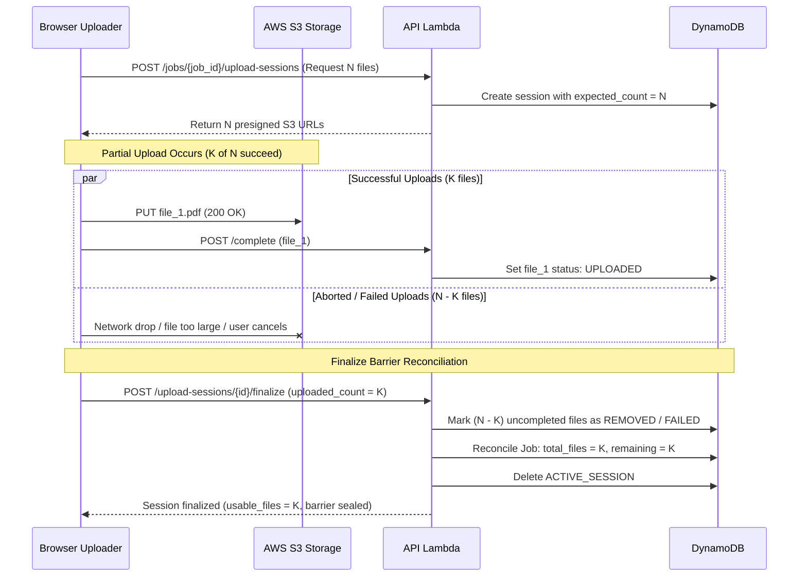
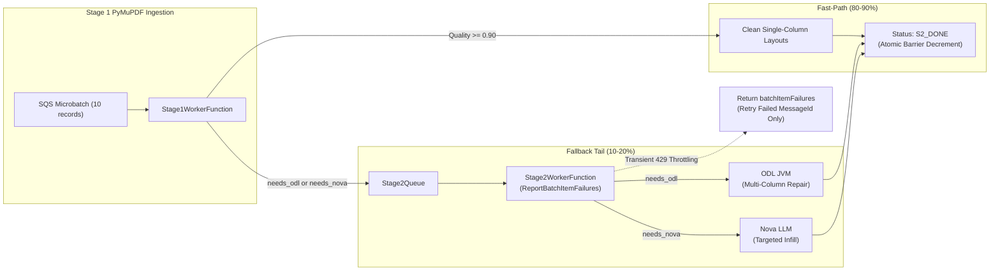
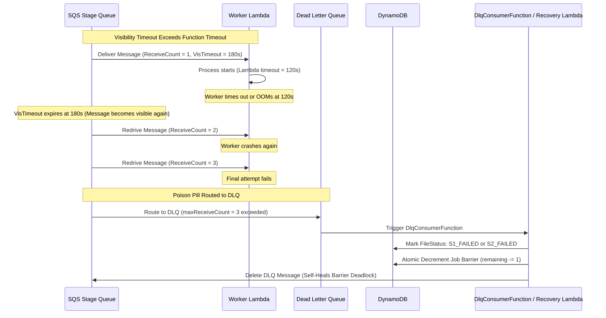
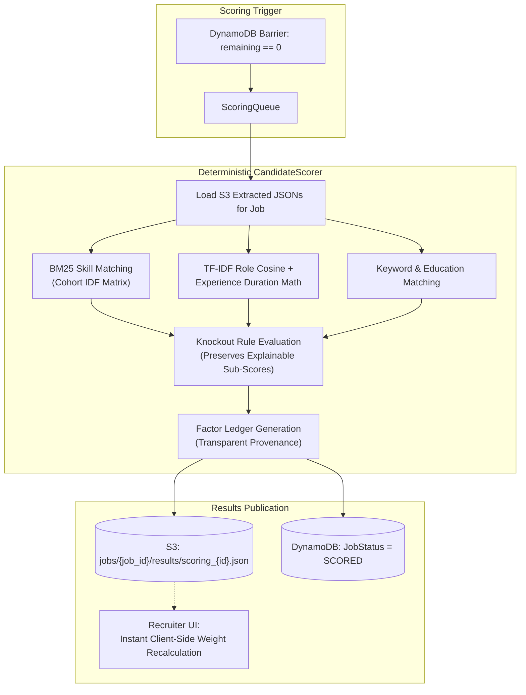
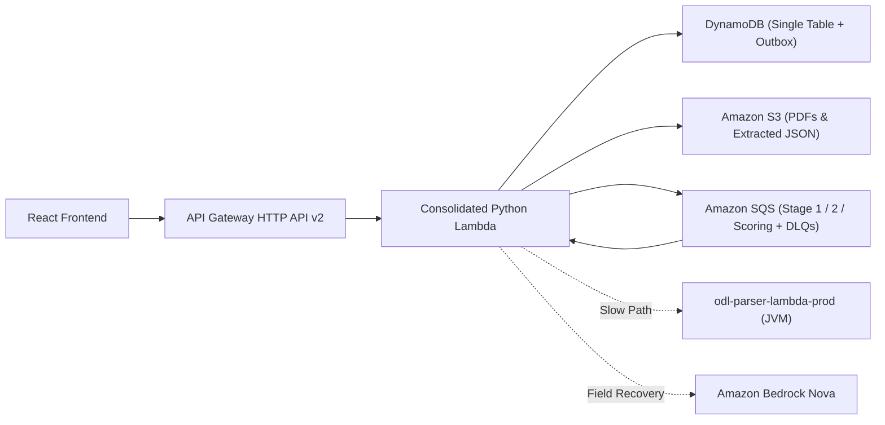
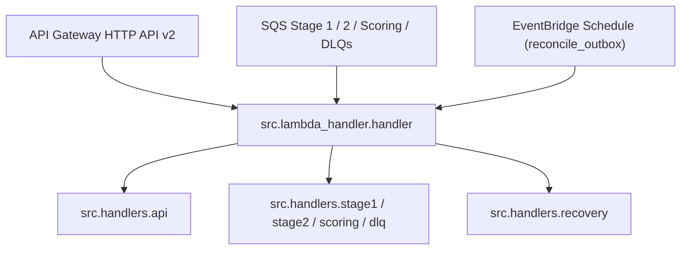

# architecture.md — SWYRA Sortlist Architecture Specification

> **Reviewed Baseline Commit:** `c9124c3de334c4b9024239acac4752a9bbb88d7e`  
> **Target Release:** `v2.2 — Durable Serverless Pipeline, Evidence Integrity, and Strict Relevance Scoring`  
> **Status:** Authoritative system architecture, serverless infrastructure, and data flow specification.

---

## 1. Architectural Principles

SWYRA Sortlist is architected as an **auditable, evidence-linked candidate review workspace**. It employs a standard AWS Serverless topology in production and a lightweight self-contained modular monolith in local development.

### Core Architectural Guarantees
1. **Direct Browser-to-S3 Uploads (Zero API Buffering):** The primary production upload path issues presigned S3 URLs (`POST /api/v2/jobs` or `POST /api/v2/jobs/{job_id}/upload-sessions`). Browsers stream multi-megabyte PDF files directly to S3 with bounded client concurrency (4–6 parallel PUT/POSTs). This eliminates multi-megabyte PDF body buffering in API Lambda RAM, reserving Lambda memory strictly for sub-50ms JSON execution (`create`, `complete`, `finalize`). The legacy backend upload proxy (`POST /api/v2/jobs/{job_id}/resumes`) is maintained strictly for local development and fallback compatibility.
2. **Consolidated Python Lambda Event Dispatcher:** Document processing and API routing in AWS are consolidated into a single unified Python 3.13 Lambda function (`resume-ranker-preprod` in preproduction, `resume-ranking-api` in production) using `src.lambda_handler.handler`. SQS stage queues remain strictly decoupled through separate AWS Event Source Mappings:
   - **`Stage1Queue` Mapping:** Bounded concurrency 3, batch size 10. Runs in memory PyMuPDF parsing and reading order layout analysis. Clean documents transition directly to `S2_DONE`.
   - **`Stage2Queue` Mapping:** Bounded concurrency 2, batch size 5. Runs layout repair via shared external OpenDataLoader parser (`odl-parser-lambda-prod`) and critical field infill via Bedrock Amazon Nova Micro.
   - **`ScoringQueue` Mapping:** Bounded concurrency 2, batch size 1. Runs deterministic multi-signal candidate scoring and BM25 ranking.
   - **Dead Letter Queue Mappings (`Stage1DLQ`, `Stage2DLQ`, `ScoringDLQ`):** Bounded concurrency 2. Handles poison messages, prevents retry loops, and maintains atomic barrier accounting.
   - **EventBridge Recovery Mapping:** Rate(5 minutes) scheduled event executes autonomous outbox and stranded job reconciliation without requiring an active browser tab.
3. **Partial Batch Failure Isolation:** All Lambda SQS event source mappings enforce `ReportBatchItemFailures`. Visibility timeouts strictly exceed function execution timeouts (`Stage1Queue` 360s > 180s, `Stage2Queue` 600s > 180s, `ScoringQueue` 360s > 180s). Transient errors on a single document retry only that specific `messageId`, never re-driving peer records in the microbatch.
4. **DynamoDB Transactional Outbox Pattern:** All file uploads and stage transitions atomically write an `OUTBOX#` record within a DynamoDB `TransactWriteItems` transaction. Retries implement exponential backoff with jitter on `TransactionConflict`.
5. **Standalone Engine Boundary (ADR-07):** Application endpoints contain no in-app authentication, passwords, or user accounts. Public production access requires an external edge reverse proxy, API Gateway custom authorizer, or VPC boundary.

---

## 2. Serverless Component Topology

```mermaid
flowchart TD
    subgraph Browser ["Client Browser (React 18 + Zustand)"]
        UI["Recruiter Review Workspace"]
        UploadZone["Resume Upload Zone (Presigned S3 PUT/POST)"]
    end

    subgraph Dispatcher ["Consolidated Python Lambda (resume-ranker-preprod / resume-ranking-api)"]
        Router["Unified Handler<br/>(src.lambda_handler.handler)"]
        API["FastAPI HTTP Router<br/>(/api/v2/jobs, /ats-check)"]
        W1["Stage 1 Worker<br/>(PyMuPDF Fast-Pass)"]
        W2["Stage 2 Worker<br/>(ODL & Nova Dispatch)"]
        W3["Scoring Worker<br/>(BM25 & ATS Math)"]
        W_DLQ["DLQ Consumer<br/>(Barrier Accounting)"]
        REC["Outbox Recovery<br/>(Scheduled Reconciler)"]
    end

    subgraph StorageLayer ["Persistence Tier (AWS ap-south-1)"]
        S3[("AWS S3 Bucket<br/>Raw PDFs & Extracted JSON")]
        DDB[("AWS DynamoDB<br/>ResumePlatform Single-Table")]
    end

    subgraph QueueLayer ["SQS Queue Tier (Separate ESMs)"]
        Q1["Stage1Queue<br/>(Vis: 360s, MaxConc: 3)"]
        Q2["Stage2Queue<br/>(Vis: 600s, MaxConc: 2)"]
        Q3["ScoringQueue<br/>(Vis: 360s, MaxConc: 2)"]
        DLQ["Dead Letter Queues<br/>(Vis: 300s, MaxConc: 2)"]
    end

    subgraph ExternalServices ["External AWS Services"]
        ODL["Shared ODL Parser Lambda<br/>(odl-parser-lambda-prod)"]
        NOVA["Amazon Bedrock<br/>(Nova Micro Infill)"]
        EB["Amazon EventBridge<br/>(rate 5 minutes)"]
    end

    %% Event Routing
    UploadZone -->|"1. Direct S3 Upload"| S3
    UploadZone -->|"2. Complete / Analyze"| Router
    Router -->|"HTTP Event"| API
    API -->|"Write Outbox & Metas"| DDB
    API -->|"Enqueue"| Q1

    %% SQS Event Source Mappings
    Q1 -->|"ESM Trigger"| Router
    Q2 -->|"ESM Trigger"| Router
    Q3 -->|"ESM Trigger"| Router
    DLQ -->|"ESM Trigger"| Router
    EB -->|"Scheduled Event"| Router

    Router -->|"SQS Stage 1"| W1
    Router -->|"SQS Stage 2"| W2
    Router -->|"SQS Scoring"| W3
    Router -->|"SQS DLQ"| W_DLQ
    Router -->|"Schedule"| REC

    W1 -->|"In-Memory Parse"| S3
    W1 -->|"Fallback Needed"| Q2
    W2 -->|"Invoke JVM Parser"| ODL
    W2 -->|"Critical Field Infill"| NOVA
    W2 -->|"Terminal S2_DONE"| DDB
    W3 -->|"Read JSONs & Rank"| S3
    W3 -->|"Persist Results"| DDB
    REC -->|"Scan Pending Outbox"| DDB
```



---

## 3. Measured AWS Preproduction Benchmark Results

Empirical results measured against deployed AWS preproduction (`resume-ranker-preprod`, `ap-south-1`):

| Workload Category | Batch Size | Wall-Clock Duration | Processing Rate | Estimated Compute Cost |
| :--- | :--- | :--- | :--- | :--- |
| **Clean Path (PyMuPDF)** | 1 resume | **2.49s** | 0.40 res/s | $0.0001 |
| **Clean Path (PyMuPDF)** | 5 resumes | **3.77s** | 1.33 res/s | $0.0004 |
| **Clean Path (PyMuPDF)** | 47 resumes | **24.81s** | 1.89 res/s | $0.0017 |
| **Clean Path (PyMuPDF)** | 100 resumes | **52.14s** | 1.92 res/s | $0.0037 |
| **Mixed Fallback (ODL+Nova)** | 1 resume | **3.13s** | 0.32 res/s | $0.0002 |
| **Mixed Fallback (ODL+Nova)** | 5 resumes | **7.04s** | 0.71 res/s | $0.0007 |
| **Mixed Fallback (ODL+Nova)** | 47 resumes | **29.11s** | 1.61 res/s | $0.0022 |
| **Mixed Fallback (ODL+Nova)** | 100 resumes | **71.13s** | 1.41 res/s | $0.0047 |

- **Peak Observed Lambda Memory:** 288 MB of 1024 MB (28.1% of ceiling).
- **Lambda Invocations & Throttles:** 0 throttles, 0 execution timeouts, 0 DLQ deliveries.
- **Resource Cleanup:** 100% ephemeral S3 staging objects purged post extraction.

---

## 3. Core Lifecycle & Recovery Path Diagrams

### Lifecycle 1: Analyze Before, During, and After Stage 1



---

### Lifecycle 2: Partial Browser Uploads & Barrier Reconciliation



---

### Lifecycle 3: SQS Worker Fallback Tail & Batch Item Failure Isolation



---

### Lifecycle 4: Expired Worker Lease & DLQ Recovery



---

### Lifecycle 5: Selected-Cohort Publication & Explainable Scoring



---

## 4. Key Architectural Clarifications

### A. Base-Table Key-Prefix Session Queries
- Active upload session verification queries DynamoDB using `PK=ORG#{org_id}` and `SK begins_with('ACTIVE_SESSION#')`.
- **Reality:** This is **not an $O(1)$ constant query, not a Global Secondary Index (GSI), and does not guarantee 1 RCU**.
- **Scalability:** It scans and reads all matching session pointers in the organization partition. To ensure predictable costs, active pointers are strictly deleted when sessions transition to `READY_TO_ANALYZE` or reach terminal states (`EXPIRED`, `FAILED`). Stale pointers are reconciled during admission.

### B. Direct S3 Upload Memory Reality
- **Client Direct Uploads:** Resumes are uploaded directly from the client browser to AWS S3 using presigned URLs.
- **Lambda Memory Reality:** Direct S3 uploads eliminate buffering multi-megabyte PDF bodies through the API Lambda memory. However, the API Lambda still consumes minimal memory for JSON requests (`create-upload-session`, `complete`, `finalize`). Memory size is set to 512 MB to support fast JSON serialization and low-latency crypto token generation.

### C. Concurrency: 6 Local Workers vs. AWS Lambda
- **Local Microbenchmark:** Spawns a maximum of 6 isolated operating system processes (`ProcessPoolExecutor`). PyMuPDF executes strictly single-threaded within each process to prevent C-library memory corruption.
- **AWS Lambda Scaling:** Lambda concurrency is **independent of local process limits**. In AWS Lambda, each invocation runs in its own isolated Firecracker microVM. Lambda scaling is governed by SQS trigger batch sizes (up to 10 records) and AWS account concurrency quotas. Six local processes does not mean six Lambda invocations.

---

## 5. Browser Lifecycle & State Recovery

- **Ephemeral Storage Scoping:** The active `job_id` is tracked exclusively in browser `sessionStorage`. Closing the tab or opening a new browser session starts cleanly with a blank state (`No Results Yet`).
- **Zero LocalStorage PII:** Resume contents, extracted text, contact details, and candidate evaluations are NEVER stored in persistent browser storage (`localStorage`).
- **In Flight Recovery:** A page reload or network reconnect during upload, extraction, or scoring queries `GET /api/v2/jobs/{job_id}/status`, seamlessly reattaching to the active DynamoDB processing state without duplicate job creation.

---

## 6. Environment Isolation & Deployment Boundaries

- **Preproduction Environment (`resume-ranker-preprod`):**
  - Dedicated DynamoDB single table (`ResumePlatformPreprod-445567096027`).
  - Dedicated S3 storage bucket (`resume-ranker-preprod-445567096027`).
  - Dedicated SQS stage and dead-letter queues (`resume-ranker-stage1-preprod`, etc.).
  - Isolated from production queues, tables, and production resume documents.
- **Shared ODL Service:**
  - Shared external parser `odl-parser-lambda-prod` is invoked using an isolated staging prefix (`pdf-test-bucket-09/preprod-staging/`), ensuring zero cross-environment contamination.
- **Edge Reverse Proxy Requirement (ADR-07):**
  - The application backend operates as an unauthenticated standalone engine.
  - Production deployments MUST enforce reverse proxy protection (CloudFront, API Gateway custom authorizer, or VPC endpoint) to prevent unauthorized public access.

---

## 7. Production Migration & Rollback Procedures

### Updating Production Lambda (`resume-ranking-api`)
```bash
# 1. Build and package consolidated artifact
sam build -t infra/template.yaml

# 2. Deploy updated code to existing production function
aws lambda update-function-code \
  --function-name resume-ranking-api \
  --s3-bucket resume-ranker-prod-storage \
  --s3-key deployments/v2.1-release.zip \
  --region ap-south-1 \
  --profile aws

# 3. Execute smoke verification
curl -s https://<prod-api-id>.execute-api.ap-south-1.amazonaws.com/health | jq .
```

### Rollback Procedure
```bash
# Instant rollback to previous verified Lambda CodeSha256
aws lambda update-function-code \
  --function-name resume-ranking-api \
  --s3-bucket resume-ranker-prod-storage \
  --s3-key deployments/v2.0-previous.zip \
  --region ap-south-1 \
  --profile aws
```


---

## 8. Architecture Diagrams

### High-Level System Architecture


### Consolidated Lambda Event Dispatcher


### Minimum EventBridge IAM Policy Required for `EnableSchedule=true`
```json
{
  "Version": "2012-10-17",
  "Statement": [
    {
      "Effect": "Allow",
      "Action": [
        "events:PutRule",
        "events:DescribeRule",
        "events:DeleteRule",
        "events:PutTargets",
        "events:RemoveTargets"
      ],
      "Resource": "arn:aws:events:ap-south-1:445567096027:rule/resume-ranker-recovery-*"
    }
  ]
}
```
